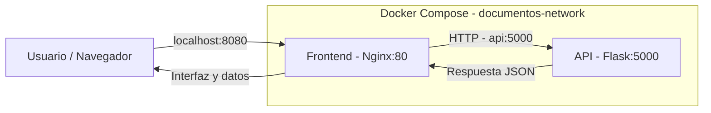
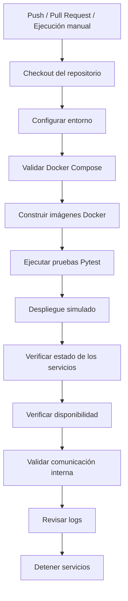

# Portal de Documentos Administrativos

Proyecto académico de DevOps - Semana 6 | IACC

## 1. Descripción del proyecto

El Portal de Documentos Administrativos es una aplicación web desarrollada para simular la centralización y consulta de documentos de una unidad administrativa.

La solución permite consultar un catálogo de documentos, visualizar sus versiones y estados, realizar búsquedas por nombre, filtrar por categoría y comprobar la disponibilidad del servicio.

El proyecto incorpora contenedores Docker, infraestructura declarativa mediante Docker Compose, control de versiones con Git e integración continua y despliegue simulado mediante GitHub Actions.

## 2. Objetivos

- Centralizar la consulta de documentos administrativos simulados.
- Implementar una arquitectura de servicios independientes.
- Garantizar la reproducibilidad del entorno de ejecución.
- Automatizar la construcción de imágenes y las pruebas.
- Validar la comunicación interna entre contenedores.
- Aplicar buenas prácticas de configuración y seguridad.

## 3. Tecnologías utilizadas

| Tecnología | Propósito |
|---|---|
| HTML5 | Estructura de la interfaz web |
| CSS3 | Diseño y presentación visual |
| JavaScript | Interactividad y consumo de la API |
| Python 3.12 | Desarrollo del backend |
| Flask | Implementación de la API REST |
| Nginx Alpine | Servidor web y proxy inverso |
| Docker | Construcción y ejecución de contenedores |
| Docker Compose | Gestión de múltiples servicios |
| Pytest | Ejecución de pruebas automatizadas |
| Git | Control de versiones |
| GitHub | Repositorio remoto |
| GitHub Actions | Automatización del pipeline CI/CD |
| Visual Studio 2022 | Entorno de desarrollo |

## 4. Arquitectura de la solución

La aplicación utiliza una arquitectura compuesta por dos servicios:

- Frontend: servidor Nginx encargado de presentar la interfaz web y redirigir las solicitudes hacia la API.
- API: servicio desarrollado en Python con Flask, encargado de proporcionar el catálogo documental y el estado del servicio.



El frontend publica el puerto 8080 del equipo anfitrión, asociado al puerto 80 del contenedor.

La API utiliza el puerto interno 5000, sin publicarlo directamente en el equipo anfitrión.

Ambos servicios se comunican mediante la red privada del proyecto denominada `documentos-network`, utilizando el nombre del servicio `api` como mecanismo de resolución interna.

## 5. Estructura del proyecto

```text
s6-proyecto-devops/
├── .github/
│   └── workflows/
│       └── ci-pipeline.yml
├── api/
│   ├── src/
│   │   └── app.py
│   ├── tests/
│   │   └── test_app.py
│   ├── Dockerfile
│   └── requirements.txt
├── config/
│   └── nginx.conf
├── evidencias/
├── frontend/
│   ├── src/
│   │   ├── index.html
│   │   ├── styles.css
│   │   └── app.js
│   └── Dockerfile
├── .dockerignore
├── .env.example
├── .gitignore
├── compose.yaml
└── README.md
```

La carpeta `evidencias` está destinada a almacenar los registros gráficos de las verificaciones realizadas durante el desarrollo.

## 6. Requisitos previos

Para ejecutar el proyecto localmente se requiere:

- Git instalado.
- Docker Desktop en ejecución.
- Docker Compose v2.
- PowerShell o una terminal compatible.
- Navegador web.
- Conexión a Internet para descargar las imágenes base y dependencias.

Verificar las herramientas instaladas:

```powershell
git --version
docker --version
docker compose version
```

## 7. Instalación y configuración

### 7.1. Clonar el repositorio

```powershell
git clone https://github.com/Taku1932/s6-proyecto-devops.git
cd s6-proyecto-devops
```

### 7.2. Configurar las variables de entorno

Crear el archivo local `.env` a partir de la plantilla proporcionada:

```powershell
Copy-Item .env.example .env
```

El archivo `.env.example` contiene valores de configuración destinados al entorno simulado.

El archivo `.env` debe mantenerse fuera del control de versiones.

### 7.3. Validar la configuración

```powershell
docker compose config
```

Este comando permite comprobar la configuración declarativa de los servicios, las variables de entorno y la red antes de iniciar el despliegue.

## 8. Ejecución de la aplicación

Construir las imágenes e iniciar los servicios:

```powershell
docker compose up -d --build
```

Verificar el estado de los contenedores:

```powershell
docker compose ps
```

Ambos servicios deben alcanzar el estado `healthy`.

Abrir la aplicación en el navegador:

http://localhost:8080

La interfaz permite:

- Visualizar el estado operativo del servicio.
- Consultar cinco documentos administrativos simulados.
- Visualizar cuatro categorías documentales.
- Buscar documentos por nombre.
- Filtrar documentos por categoría.
- Consultar versiones y estados.
- Actualizar el catálogo.

## 9. Endpoints de la API

| Método | Endpoint | Descripción |
|---|---|---|
| GET | /health | Consulta el estado del servicio |
| GET | /api/documentos | Obtiene el catálogo documental |

Los endpoints pueden consultarse mediante el proxy inverso de Nginx:

- http://localhost:8080/health
- http://localhost:8080/api/documentos

Ejemplo de respuesta del endpoint `/health`:

```json
{
  "environment": "development",
  "service": "Portal de Documentos Administrativos",
  "status": "ok"
}
```

## 10. Pruebas automatizadas

Para construir la imagen de la API y ejecutar las pruebas:

```powershell
docker compose build api
docker compose run --rm api python -m pytest tests/ -v
```

Las pruebas implementadas verifican:

| Prueba | Validación |
|---|---|
| test_health_status | Código HTTP del endpoint de salud |
| test_health_respuesta | Contenido de la respuesta de salud |
| test_documentos_status | Código HTTP del catálogo |
| test_documentos_json | Formato JSON de la respuesta |
| test_documentos_contenido | Contenido del catálogo documental |
| test_ruta_inexistente | Comportamiento ante una ruta inexistente |

Durante la ejecución inicial del pipeline se obtuvieron seis pruebas aprobadas de un total de seis.

## 11. Integración continua y despliegue simulado

El pipeline se encuentra definido en:

`.github/workflows/ci-pipeline.yml`

Su ejecución se activa mediante:

- Push sobre la rama main.
- Pull request dirigido a la rama main.
- Ejecución manual mediante workflow_dispatch.

El pipeline utiliza un runner Ubuntu proporcionado por GitHub Actions.

### Etapas del pipeline



El despliegue se realiza dentro del entorno temporal de GitHub Actions, sin publicar la aplicación en un servidor externo de producción.

## 12. Verificación de la comunicación interna

Con los servicios en ejecución, utilizar el siguiente comando:

```powershell
docker compose exec frontend wget -qO- http://api:5000/health
```

La respuesta debe incluir el atributo `"status":"ok"`.

Esta comprobación permite validar la resolución del nombre del servicio y la comunicación entre los contenedores mediante la red interna de Docker Compose.

## 13. Monitoreo y revisión de logs

Consultar los registros de ambos servicios:

```powershell
docker compose logs --tail=30
```

Consultar individualmente los registros:

```powershell
docker compose logs frontend
docker compose logs api
```

Durante las verificaciones realizadas se observaron respuestas HTTP 200 en los endpoints `/health` y `/api/documentos`.

También se observaron comprobaciones periódicas de disponibilidad mediante los healthchecks configurados.

## 14. Detención controlada

Para detener y eliminar los contenedores y la red del proyecto:

```powershell
docker compose down
```

Verificar que no existan contenedores asociados al proyecto:

```powershell
docker compose ps -a
```

El resultado esperado corresponde a una tabla sin contenedores registrados.

## 15. Seguridad y buenas prácticas

El proyecto incorpora las siguientes medidas:

- Separación de la configuración mediante variables de entorno.
- Uso de `.env.example` como plantilla de configuración.
- Exclusión del archivo `.env` mediante `.gitignore`.
- Uso de `.dockerignore` para limitar archivos innecesarios en el contexto de construcción.
- Comunicación entre servicios mediante una red interna.
- API sin publicación directa de su puerto en el equipo anfitrión.
- Permisos de lectura para el contenido del repositorio en GitHub Actions.
- Comprobaciones automáticas de disponibilidad.
- Validación de la infraestructura antes del despliegue.
- Utilización de información documental ficticia.
- Control de versiones y trazabilidad de los cambios.

## 16. Incidencias y acciones correctivas

Durante la primera ejecución del pipeline se identificó una advertencia relacionada con la obsolescencia de Node.js 20, utilizado por la acción `actions/checkout@v4`.

Aunque la advertencia no provocó una falla en la ejecución, se actualizó la dependencia a:

```yaml
uses: actions/checkout@v5
```

Posteriormente, se registró el cambio mediante Git y se publicó en GitHub, generando una nueva ejecución automática del pipeline.

La segunda ejecución finalizó correctamente, sin mostrar la advertencia anterior en el resumen.

Esta acción permitió mejorar la compatibilidad del workflow con Node.js 24 y mantener la trazabilidad de la modificación.

## 17. Resultados obtenidos

| Verificación | Resultado |
|---|---|
| Validación de Docker Compose | Exitosa |
| Construcción de imágenes Docker | Exitosa |
| Pruebas automatizadas | 6 de 6 aprobadas |
| Primera ejecución del pipeline | Exitosa - 39 segundos |
| Segunda ejecución del pipeline | Exitosa - 40 segundos |
| Estado de los contenedores | Healthy |
| Disponibilidad de la API | HTTP 200 |
| Comunicación interna | Exitosa |
| Búsqueda por nombre | Exitosa |
| Filtro por categoría | Exitoso |
| Actualización del catálogo | Exitosa |
| Detención de los servicios | Exitosa |

Los resultados permiten comprobar que la solución funciona tanto en el entorno local como en el entorno simulado de GitHub Actions.

## 18. Mejoras futuras

- Incorporar autenticación y autorización de usuarios.
- Implementar una base de datos persistente.
- Incorporar almacenamiento y gestión real de documentos.
- Utilizar un servidor WSGI de producción, como Gunicorn.
- Incorporar análisis automatizado de vulnerabilidades.
- Implementar monitoreo centralizado y alertas.
- Ampliar la cobertura de pruebas automatizadas.
- Incorporar estrategias de despliegue Blue-Green o Canary en futuros entornos.

## 19. Referencias técnicas

- Docker Documentation: https://docs.docker.com/
- GitHub Actions Documentation: https://docs.github.com/en/actions
- Flask Documentation: https://flask.palletsprojects.com/
- Pytest Documentation: https://docs.pytest.org/
- Nginx Documentation: https://nginx.org/en/docs/

## 20. Autor

Paul Rivera

Instituto Profesional IACC

Asignatura: DevOps (DEVPS1301)

Semana 6 - 2026

Proyecto desarrollado con fines académicos en un entorno simulado.
